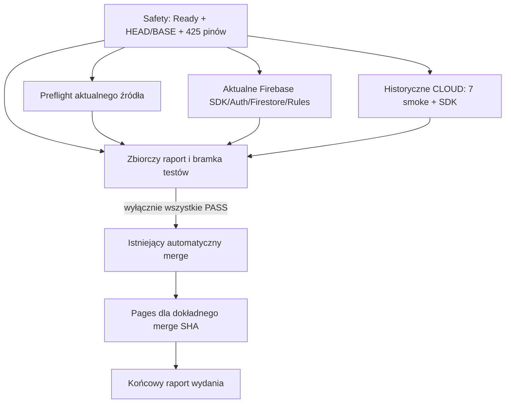

# PR #84 — niezależne grupy CI i pełna diagnostyka

Gałąź `local-first-sync-durable-20261028`; wejściowy HEAD `8d69955feb61799e7ea0361468dc76ff0cab06e7`; BASE/main `149f9a126a85f9972f5fc1cd19afdc264be98cc7`. Nowy HEAD wskazuje końcowy raport i referencja gałęzi. Jeden commit implementacyjny, bez uruchomienia CI, Draft/Ready, nowego PR, merge, Pages i Firebase LIVE.

## Nowy przebieg jednej zatwierdzonej próby

Preflight, aktualne Firebase i historyczne CLOUD mają własne runnery Ubuntu i zależą wyłącznie od `safety`. Nie mają zależności między sobą. FAIL, SKIPPED albo błąd Chromium w Preflight nie blokuje pozostałych bezpiecznych grup. Macierzy fail-fast nie ma; zachowano dotychczasowe anulowanie starszej próby tego samego PR. Świadome anulowanie lub utrata runnera nie mogą być przedstawiane jako PASS.

Historyczne smoke przeniesiono do zadania CLOUD, a nie usunięto. `preflight.js --current-only` wykonuje wszystkie dotychczasowe aktualne smoke; domyślne wywołanie bez argumentu nadal obsługuje oba konteksty. `cloud-ci-historical.js` uruchamia dokładnie niezmienioną listę siedmiu historycznych smoke z frozen checkout. Jego błąd asercji nie blokuje SDK tego samego zadania. Brak Javy lub zależności SDK nie blokuje historycznych smoke. Wszystkie pliki SDK pozostają przypisane dokładnie raz przez istniejący `sdkPlan`; jawny selektor `--context=current` / `--context=historical` rozdziela wykonanie na hosty. Domyślny runner SDK bez selektora zachowuje oba konteksty.

## Bezpieczeństwo i pominięcia

- `safety` odczytowo porównuje zdarzenie opened/ready_for_review z bieżącym otwartym, niescalonym PR Ready, repo źródła, HEAD, BASE i rzeczywistym main. Każdy checkout używa dokładnego zatwierdzonego HEAD, nie ruchomej nazwy gałęzi ani syntetycznego merge ref.
- Każdy runner odtwarza własny izolowany checkout `306f90a4cfd8bcb4277aa8b4d140e911493ddd60`. `cloud-ci-prepare.js` sprawdza HEAD, pochodzenie od BASE, czystość śledzonego źródła, istniejące `verifyHistorical()` i `sdkPlan()`, w tym 425 pinów i integralność testów historycznych. Nie przepisuje manifestów ani pinów. Nie przenosi roboczej bazy czy profilu między zadaniami.
- Gdy wspólna bramka źródeł nie przejdzie, trzy grupy są SKIPPED, z powodem z `safety`. To wspólny niespełniony warunek bezpieczeństwa, nie pominięcie z powodu Preflight FAIL. Błąd lokalnego przygotowania danego runnera blokuje tylko jego testy; pozostałe zadania zbierają diagnostykę.
- Bezpośrednio przed każdym SDK osobny `sdk-safety` ponownie sprawdza źródło/piny, dostępność CLI oraz istniejące ścisłe warunki emulatorów: loopback, porty Auth 19099 i Firestore 18080, singleProjectMode i wyłączone UI. Odmowa bramki oznacza jej FAIL, SDK SKIPPED i dokładny kod powodu, np. `CLOUD_CI_HISTORY_SHA_MISMATCH`, `CLOUD_CI_EMULATOR_CONFIG_UNSAFE` lub `CLOUD_CI_SDK_DEPENDENCIES_REQUIRED`. Nie odpala się emulatora, żeby sprawdzić, czy odmowa była konieczna.
- Rzeczywisty runner nadal wymusza `--project demo-meble-app --only auth,firestore`, czyści poświadczenia z otoczenia, używa przypiętych zależności i odmawia innych adresów. `completeTap` nadal wymaga dodatniej liczby testów, zgodnego PASS oraz zera fail/cancelled/skipped/todo. Nie dodano trybu LIVE ani obejścia operatora.
- Nie użyto `continue-on-error`, fikcyjnego PASS ani zmiany asercji aplikacji/Firebase. Ochrona dokładnego HEAD/BASE pozostaje też bezpośrednio przed merge; dodatkowo odmawia się zmiany docelowej gałęzi z main nawet przy takim samym SHA.

## Raporty i wydanie

Każda grupa zapisuje wynik oraz PASS/FAIL/SKIPPED wymaganych kroków do GitHub Step Summary. Błędy przygotowania mają kod lub nazwę nieudanego kroku, a pominięte SDK widoczny brak spełnionych zależności. Logi tekstowe testów trafiają do osobnych artefaktów `diagnostics-preflight`, `diagnostics-firebase-current`, `diagnostics-cloud-historical`. Profile, IndexedDB, tokeny, oryginalny rollback i prywatne pliki nie są artefaktami. Zachowano diagnostykę zasobów Chromium z poprzedniego pakietu.

Pipelining zachowuje kod testowanego procesu i osobno sprawdza błąd zapisu przez tee. Nie można uzyskać PASS, jeżeli utracono zapis logu. Błędy spawn są również wypisywane. Artefakt bez pliku po odmowie wykonania nie daje potwierdzenia testu: raport nadal wskazuje FAIL/SKIPPED.

`ci-summary` działa przez `always()` po wszystkich trzech grupach i `safety`. Zestawia ich wyniki, przyczyny pominięć oraz ponownie odczytuje świeży HEAD/BASE/main i stan Ready. Dopiero wszystkie job results `success`, raporty `PASS` i zgodna tożsamość dają `RELEASE_READY` jako bramkę testów. Każdy FAIL, wymagany SKIPPED, cancelled, brak raportu, sprzeczny wynik lub niepewny odczyt daje `RELEASE_BLOCKED` i nieudane zadanie agregacji.

Auto-merge zależy bezpośrednio od wszystkich obowiązkowych grup i agregacji, a nie tylko od zielonego Preflight. Pages zachowuje zależność od prawidłowego automatycznego merge i dokładnego merge SHA. Końcowy Step Summary oraz dotychczasowy komentarz wydaniowy pokazują `RELEASE_READY` dopiero po PASS grup, merge i Pages; w pozostałych przypadkach `RELEASE_BLOCKED`. Nie wykonano żadnego komentarza ani operacji wydaniowej w tym zadaniu — opis dotyczy przyszłego zatwierdzonego workflow.

## Kontrole wykonane lokalnie

**9 celowanych grup PASS**, wywołano wyłącznie `diagnosticChecks()` / `workflowChecks()`, bez pełnej historycznej regresji:

1. Rzeczywisty DAG workflow, mutacje zależności/bramek/checkout/triggerów muszą zostać odrzucone.
2. FAIL Preflight lub aktualnego SDK nie blokuje innych bezpiecznych zadań; FAIL smoke nie blokuje SDK, brak zależności SDK nie blokuje historycznych smoke.
3. Rzeczywiste skrypty raportowania zachowują FAIL/SKIPPED i przyczyny niewykonanych kroków.
4. Rzeczywisty agregator: 125 kombinacji trzech grup, dodatkowo brak i sprzeczne potwierdzenia — brak drogi do wydania przy FAIL/SKIPPED/niepewności.
5. Zmienione HEAD/BASE/main, cofnięcie Ready, zamknięcie/retarget PR, niedostępne API i niezatwierdzone zdarzenie blokują bramkę.
6. Oryginalne pliki SDK są przypisane dokładnie raz; obcy/podwójny selektor odmawia wykonania.
7. Rzeczywiste guardy przygotowania na syntetycznym lokalnym repo: błędne SHA, brudne źródło i niebezpieczna ścieżka odmawiają przed klonowaniem/instalacją/testami.
8. Rzeczywisty guard konfiguracji emulatora: błędny host/port/tryb/UI lub brak CLI odmawiają przed uruchomieniem.
9. Rzeczywisty kod powłoki z kontrolowanym producentem logu: zachowany niezerowy exit producenta oraz FAIL przy błędzie tee. Nie uruchamia Preflight ani Firebase.

YAML sparsowany; zależności ośmiu zadań są poprawne i acykliczne. Kontrola składni wszystkich bloków bash, dziewięciu inline github-script oraz sześciu zmienionych/nowych plików JS: PASS. Diff i brak zmian pakietu Chromium, kodu aplikacji, Rules oraz historycznych manifestów/testów: sprawdzone. Nie zaliczono nowego pełnego CI i nie powtarzano wcześniejszych audytów ani testów Chromium.

## Pliki i status

Zmienione: `.github/workflows/preflight-js.yml`, `tools/preflight.js`, `tools/cloud-ci-emulators.js`, `tools/cloud-ci-reliability-smoke.js`. Nowe: `tools/cloud-ci-prepare.js`, `tools/cloud-ci-historical.js`, `tools/cloud-ci-workflow-checks.js`, `tools/reports/pr84-independent-ci-diagnostics.md`. W istniejącym smoke zaktualizowano wyłącznie nieaktualne oczekiwanie o pomijaniu SDK po FAIL Preflight; pozostałe testy integralności/odmowy IO zachowano.

**CODE_READY / CI_PENDING / RELEASE_BLOCKED / LIVE_BLOCKED.** Wymagany dowód: jedna osobno zatwierdzona próba tego workflow dla nowego HEAD i niezmienionego BASE. Bez niej nie potwierdzamy działania nowej organizacji na GitHubie. Awaria/anulowanie runnera lub samego raportowania może ograniczyć dostępne logi; nie daje prawa do wydania i pozostaje jawnym brakiem dowodu.
